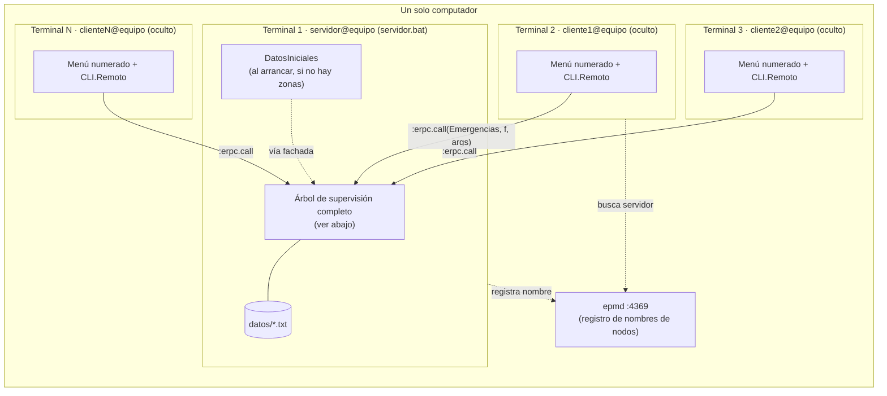
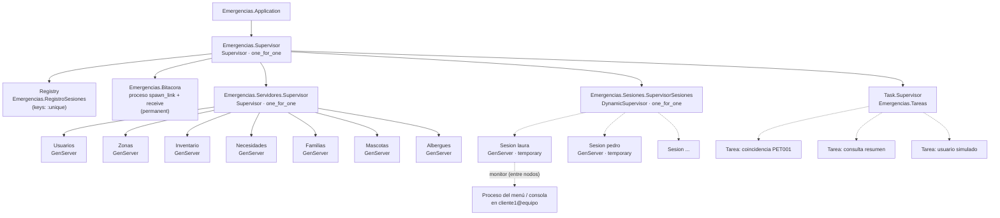

# 1.8 Diagrama de procesos y supervisión (árbol OTP)

## Nodos: una terminal por usuario en el mismo computador

* El servidor arranca con `--sname servidor`, lo que inicia `epmd` y registra el nombre.
* Cada cliente (`mix cliente`) toma el primer nombre libre `clienteN`, usa la misma
  cookie (`emergencias`) y se conecta al servidor. Los clientes son nodos **ocultos**:
  solo se conectan con el servidor, no entre sí.
* `DatosIniciales` no es un proceso: es código que `mix servidor` ejecuta una vez, después
  de iniciar el árbol, y que registra los datos de muestra llamando a la fachada.
* Los clientes NO inician la aplicación: no tienen GenServers ni escriben archivos.
  El estado vive únicamente en el servidor, por eso todos ven lo mismo y la
  concurrencia se resuelve en un solo lugar.
* La `Sesion` de cada usuario (en el servidor) monitorea el proceso de la consola
  (en el cliente). Si la terminal se cierra o su nodo cae, llega un `:DOWN` con
  motivo `:noconnection` y la sesión termina sola.

## Árbol de supervisión del nodo servidor

Líneas punteadas: hijos dinámicos creados en tiempo de ejecución.

## Decisiones de supervisión

| Proceso | Tipo | Reinicio | Por qué |
|---|---|---|---|
| `Emergencias.Supervisor` | Supervisor `one_for_one` | — | Los hijos son independientes; la caída de uno no debe tumbar a los demás. |
| `Registry` | Registry único | permanent | Garantiza una sola sesión por usuario (`{:via, Registry, ...}`). |
| `Bitacora` | proceso propio (`spawn_link`) | permanent | Evidencia paso de mensajes "a mano"; registrar es asíncrono (`send`). Al reiniciarse relee `actividad.txt`. |
| `Tareas` | `Task.Supervisor` | permanent | Tareas cortas y paralelas (coincidencias, resumen, simulación). Se usa `async_stream_nolink`: si una tarea falla no afecta a quien la lanzó. |
| `Servidores.Supervisor` | Supervisor `one_for_one` | permanent | Cada GenServer es dueño de un archivo distinto y recarga su estado en `init/1`; reiniciar uno no requiere reiniciar los otros. `Inventario` arranca antes que `Necesidades`, que lo llama. |
| GenServers del dominio | GenServer | permanent | Estado compartido + serialización de operaciones concurrentes. |
| `SupervisorSesiones` | DynamicSupervisor | permanent | Las sesiones aparecen y desaparecen con `connect`/`disconnect`; no se conocen al arrancar. |
| `Sesion` | GenServer | **temporary** | Si una sesión falla no se reinicia: el usuario vuelve a conectarse. Monitorea a la consola (que puede estar en otro nodo) y se cierra sola si esta muere o si su terminal se desconecta. |

La tolerancia a fallos está probada en `test/servidores/supervision_test.exs`
(se mata `Inventario`, `Necesidades` y `Bitacora` con `Process.exit(pid, :kill)` y se
verifica que se reinician con sus datos) y en `test/distribuido_test.exs` (se detiene
el nodo de una terminal y se verifica que su sesión se cierra en el servidor).
