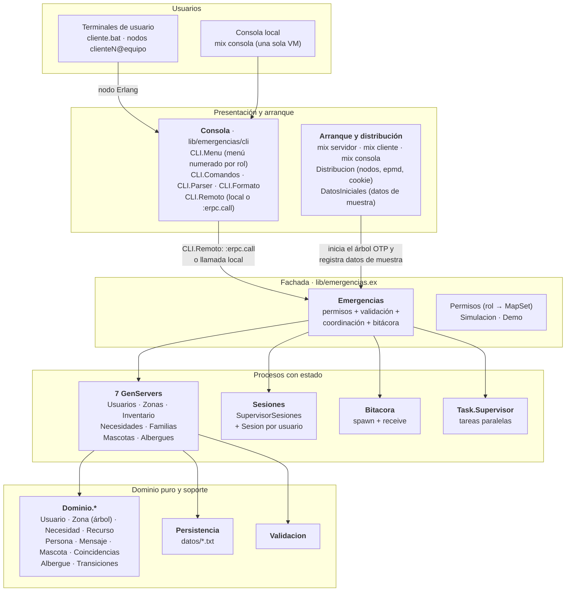

# 2.1 Diagrama de arquitectura de módulos

El sistema está organizado en capas. Cada capa solo conoce a la de abajo.

## Responsabilidades

| Capa | Módulos | Responsabilidad |
|---|---|---|
| Presentación | `CLI.Menu`, `CLI.Consola`, `CLI.Comandos`, `CLI.Parser`, `CLI.Formato` | Menú numerado (solo muestra las opciones que el rol permite y pide los datos uno a uno) o comandos escritos. El menú convierte cada opción en la misma línea de comando que se escribiría a mano, así ambos modos comparten validación y formato. Al conectarse, el menú consulta si el usuario ya existe: a uno registrado solo le pide la contraseña. Sin lógica de negocio. |
| Distribución | `CLI.Remoto`, `Distribucion`, `Mix.Tasks.Servidor`, `Mix.Tasks.Cliente` | Convertir cada terminal en un nodo Erlang y ejecutar las llamadas a la fachada en el nodo servidor (`:erpc`). En modo local `Remoto` llama directo. |
| Arranque | `Mix.Tasks.*`, `DatosIniciales` | Iniciar servidor, clientes o consola local. Si no hay zonas registradas, `DatosIniciales` carga los datos de muestra (comunas de Armenia, un usuario por rol con clave `0000`, recursos, personas, necesidades, mensajes y mascotas) **a través de la fachada**, por lo que pasan por los mismos permisos y validaciones que cualquier usuario. |
| Fachada | `Emergencias` | Única API pública. Verifica permisos, valida referencias entre módulos (zona existe, albergue existe...), coordina varios GenServers y registra la actividad. |
| Procesos | `Servidores.*`, `Sesiones.*`, `Bitacora` | Dueños del estado. Serializan las operaciones concurrentes y persisten cada cambio. |
| Dominio | `Dominio.*` | Estructuras y funciones puras (validación, transiciones, cálculos, recursión). Fáciles de probar. |
| Soporte | `Persistencia`, `Validacion` | Lectura/escritura de texto plano y validaciones reutilizables. |

En modo multiusuario cada terminal (`cliente.bat`) es un nodo cliente que solo tiene
la capa de presentación; la fachada, los procesos y los datos viven en el nodo servidor
(ver [arbol_otp.md](arbol_otp.md)).

La interfaz web futura solo necesitará llamar a las funciones de `Emergencias`, igual que hace hoy la consola.
