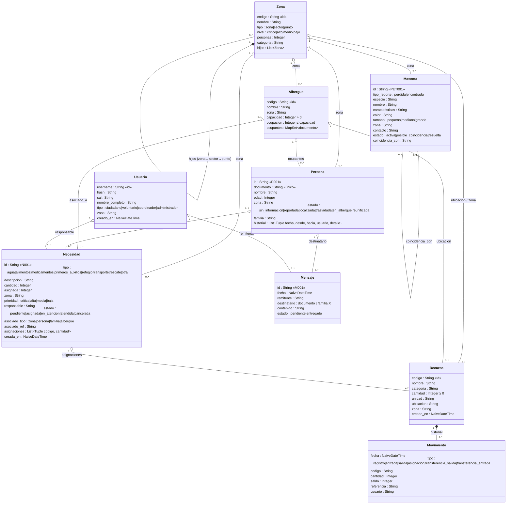
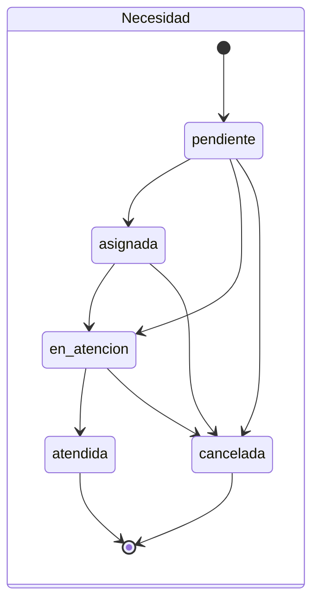
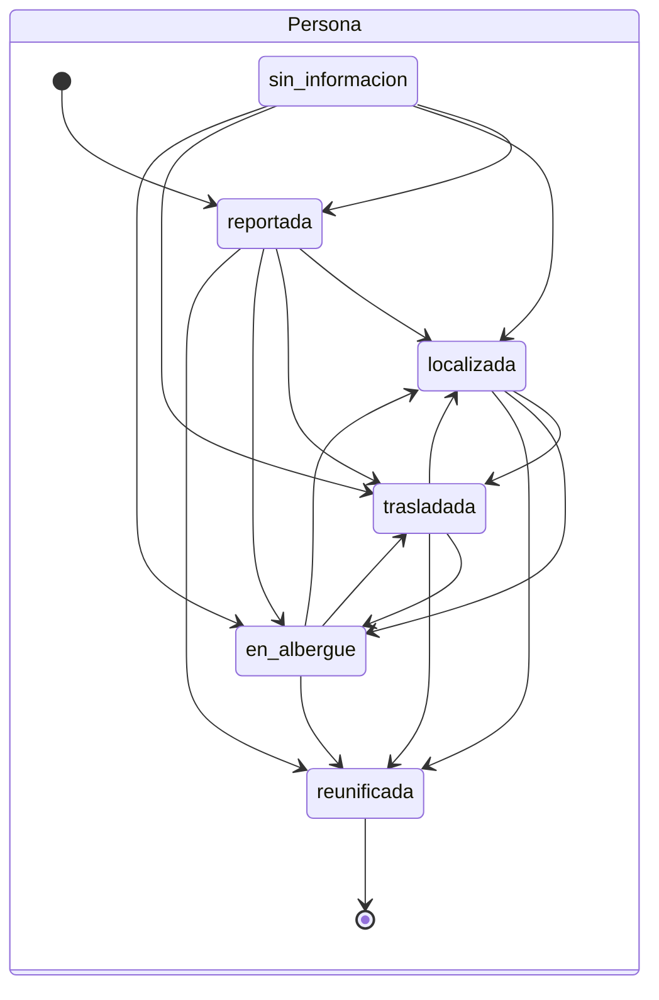
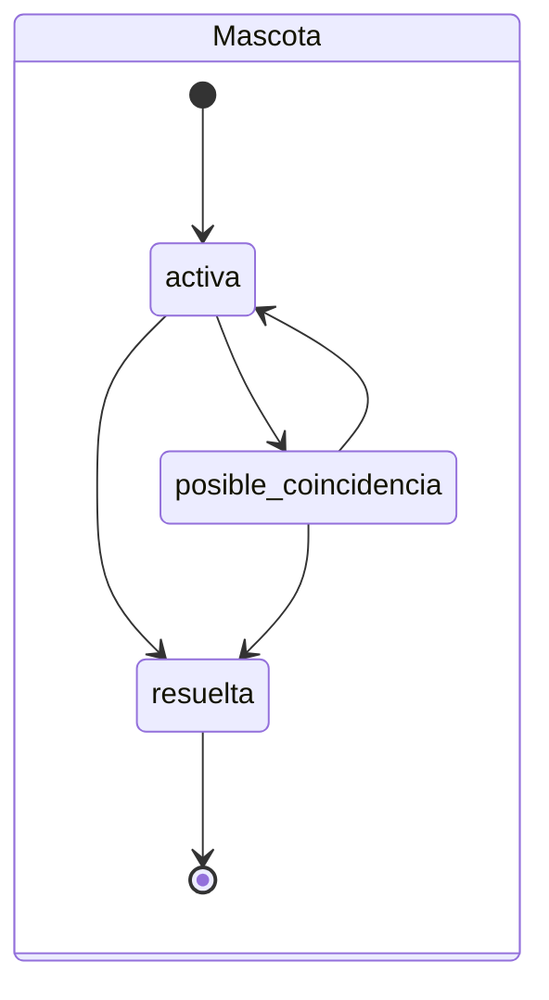
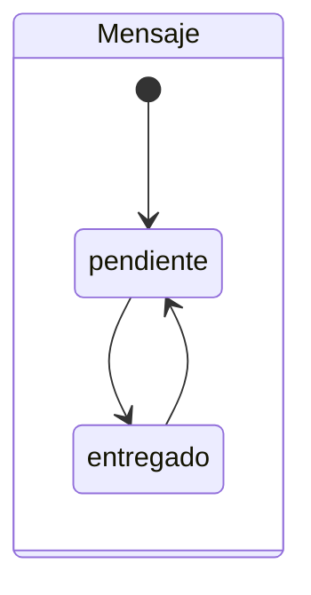

# 1.6 Modelo de datos

## Máquinas de estado (`Dominio.Transiciones`)

Cada máquina es un mapa `estado => MapSet de destinos válidos`. Los estados sin salidas
son terminales: un registro en ese estado ya no puede modificarse ni cerrarse de nuevo.

Una persona puede registrarse directamente en cualquier estado (por defecto `reportada`).

## Archivos de texto plano (`datos/`)

| Archivo | Contenido | Escritura |
|---|---|---|
| `usuarios.txt` | `username\|hash\|sal\|nombre\|tipo\|zona\|creado_en` | reescritura atómica |
| `zonas.txt` | `codigo\|nombre\|tipo\|nivel\|personas\|categoria\|padre` (preorden) | reescritura atómica |
| `necesidades.txt` | una necesidad por línea, asignaciones como `R001:30;R002:5` | reescritura atómica |
| `recursos.txt` | un recurso por línea | reescritura atómica |
| `movimientos.txt` | historial de inventario | solo inserción |
| `personas.txt` / `historial_personas.txt` | personas / cambios de estado | reescritura / solo inserción |
| `mensajes.txt`, `mascotas.txt`, `albergues.txt` | un registro por línea (ocupantes como `doc1;doc2`) | reescritura atómica |
| `actividad.txt` | bitácora de acciones por usuario | solo inserción |
