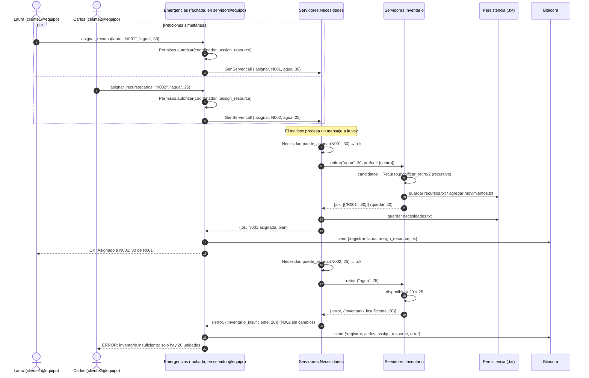
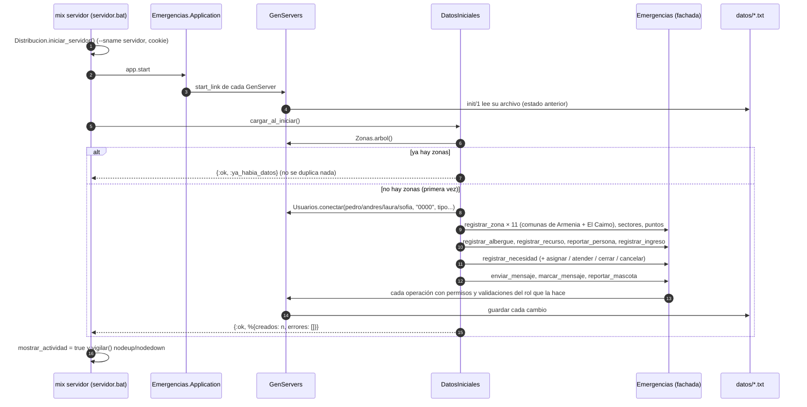
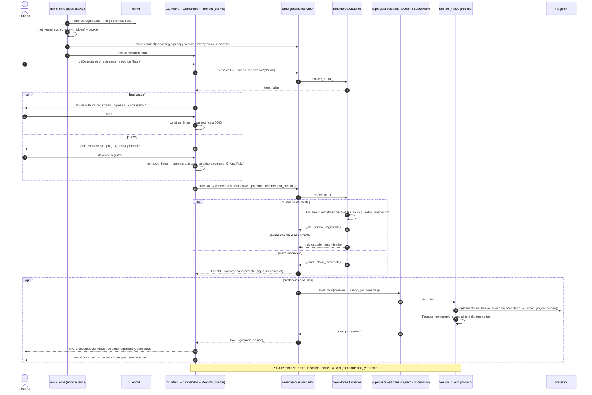
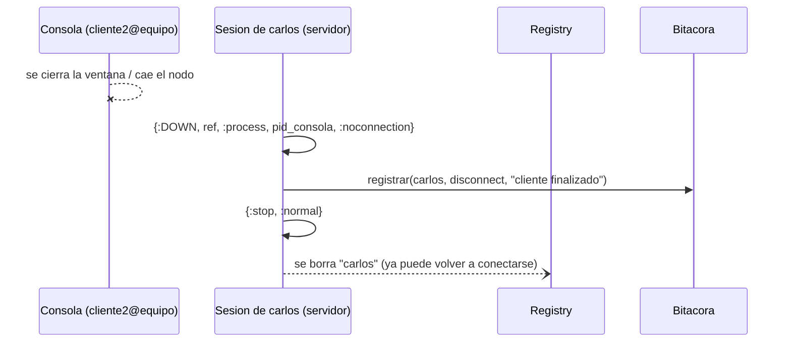
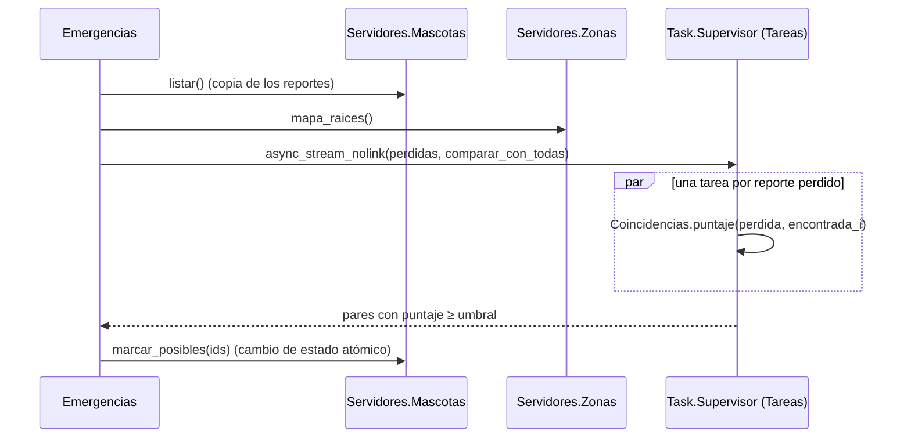

# 1.7 Diagramas de secuencia

## Asignación concurrente de recursos (flujo de ejemplo del enunciado)

Laura y Carlos, cada uno en su propia terminal (nodos `cliente1` y `cliente2`), piden
al mismo tiempo 30 y 25 litros de agua; solo hay 50. Cada terminal envía la llamada
al nodo servidor con `:erpc.call(servidor, Emergencias, :asignar_recurso, args)`.

## Arranque del servidor con datos de muestra

## Apertura de una terminal y conexión desde el menú

El menú pregunta primero el usuario y consulta al servidor si existe: a un usuario
registrado solo le pide la contraseña; a uno nuevo, los datos de registro.

## Terminal cliente que se cierra sin `disconnect`

## Búsqueda de coincidencias de mascotas (trabajo paralelo)

